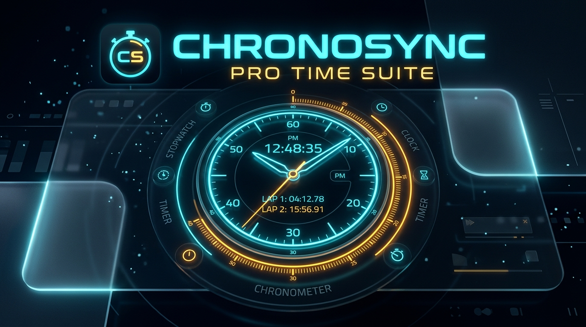

# ChronoSync - Pro Time Suite

An ultra-sleek, OLED dark-themed web and mobile application featuring a World Clock, Smart Alarm, Precision Stopwatch, and Countdown Timer with synthesized Web Audio ringtones.

## ✨ Features
- **🌐 World & Analog/Digital Clock**: Canvas analog clock with smooth-sweeping second hand, 12h/24h toggle, date & week display, and multi-timezone world clock.
- **⏰ Smart Alarm Suite**: Multiple alarms with repeat days, synthesized custom ringtones (Celestial, Pulse, Siren, Sunrise, Classic), snooze, and fullscreen ringing overlay.
- **⏱️ Precision Stopwatch**: Millisecond accuracy, lap splits, automatic fastest/slowest lap detection, and clipboard export.
- **⏳ Countdown Timer**: Circular SVG progress ring, quick presets (1m, 3m, 5m, 10m, Pomodoro 25m, 30m, 60m), and background timestamp recovery.
- **🎨 Glassmorphic Themes**: Cyber Cyan, Solar Amber, Neon Violet, and Matrix Emerald.
- **📦 Play Store Ready (PWA)**: Includes manifest, service worker for 100% offline support, high-res icons, and a full Play Store publishing guide.

## 🚀 Live Demo & Deployment
You can deploy this repository directly to **GitHub Pages**:
1. Go to your repository **Settings > Pages**.
2. Under **Build and deployment > Branch**, select `main` (or `master`) and `/ (root)`.
3. Click **Save**. Your app will be live on `https://<username>.github.io/<repo-name>/`.

## 📱 Publishing to Google Play Store
Follow the complete step-by-step instructions in [PLAYSTORE_UPLOAD_GUIDE.md](PLAYSTORE_UPLOAD_GUIDE.md).
